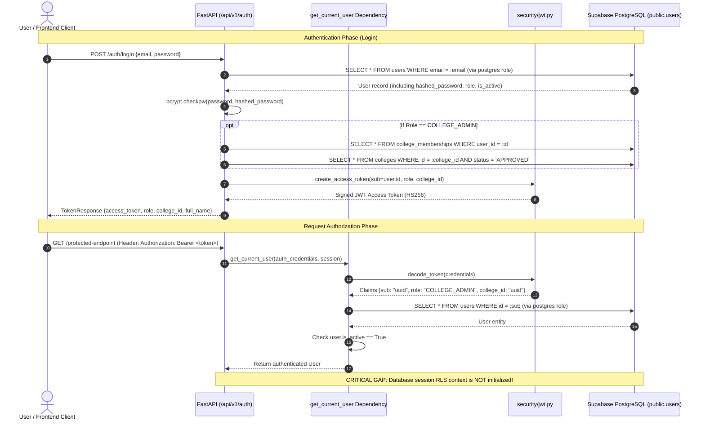
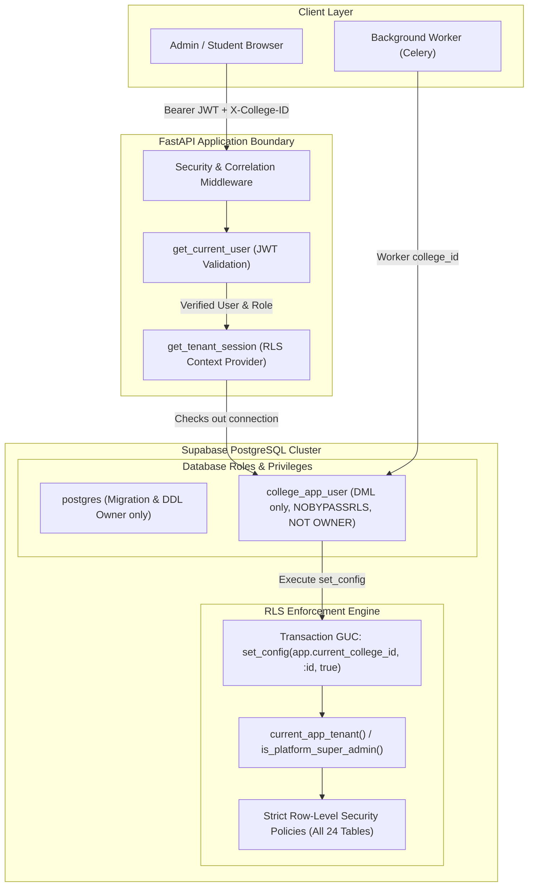
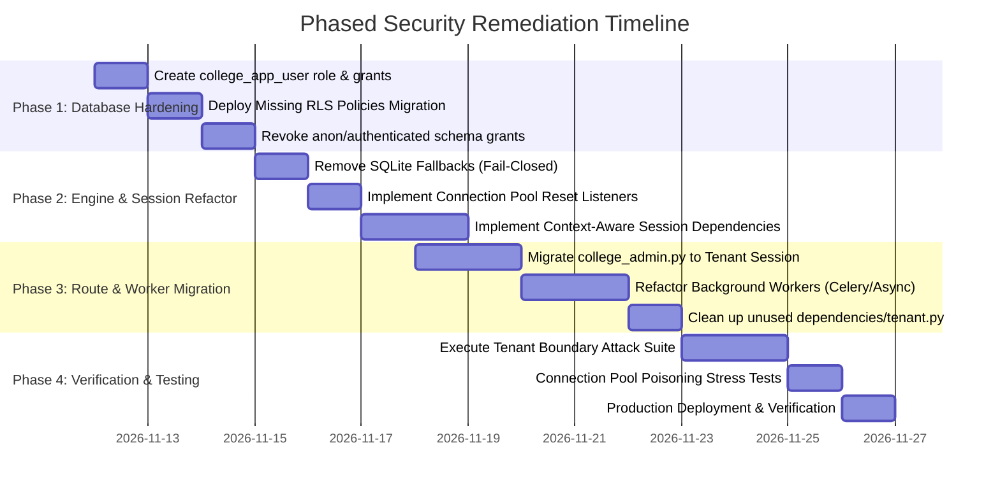

# Database Connection & Multi-Tenant Security Architecture Audit
**AI FAQ College Chat Bot Platform**  
**Audit Status:** Complete — Read-Only Architectural Inspection  
**Audit Target:** FastAPI Backend, SQLAlchemy ORM, PostgreSQL (Supabase pgvector), RLS Engine  
**Classification:** Confidential Security Engineering Audit  

---

## Executive Summary

An architectural security audit was conducted on the database connection, session lifecycle, and tenant isolation mechanisms of the **AI FAQ College Chat Bot** backend. 

The application is architected as a multi-tenant SaaS platform where multiple higher-education institutions (e.g., Ahmedabad Institute of Technology [AIT] and RC Technical Institute [RCTI]) share a single PostgreSQL database cluster with `pgvector`. Tenant isolation is intended to be enforced via PostgreSQL Row-Level Security (RLS) policies conditioned on two database session functions:
1. `public.current_app_tenant()` — reading `app.current_college_id`
2. `public.is_platform_super_admin()` — reading `app.is_super_admin`

### Core Finding
**Currently, database-level tenant isolation is entirely non-functional and completely bypassed.** 

The FastAPI backend connects to PostgreSQL using the administrative `postgres` database role. In PostgreSQL, the `postgres` role possesses the `BYPASSRLS` privilege and is the table owner, which instructs the PostgreSQL query planner to bypass all Row-Level Security policies automatically. Furthermore, the backend codebase **never sets** `app.current_college_id` or `app.is_super_admin` on any session or connection across any route or background task. 

As a result:
- The custom PostgreSQL RLS functions always evaluate to `NULL` (for tenant ID) and `FALSE` (for super-admin status).
- Any application-level query defect, missed `WHERE college_id = :id` clause, or raw SQL invocation has unrestricted visibility into all colleges' documents, extracted facts, crawler events, student conversations, and support tickets.
- If a non-administrative role were configured today without modifying the session initialization, the application would immediately suffer a platform-wide denial of service because multiple RLS-enabled tables have **zero** policies defined, causing PostgreSQL to enforce default-deny.
- Background tasks (Celery workers and async background tasks) open unmanaged database sessions that completely bypass FastAPI's request-scoped dependency injection and execute raw administrative queries with no tenant context.
- If the PostgreSQL engine fails during startup, the application silently falls back to an in-memory SQLite database, which loses all data upon process restart, lacks RLS, lacks vector search, and creates split-brain state across worker processes.

This document provides a complete inventory of every connection and session access path, maps the complete authentication and tenant authorization flows, details the architectural vulnerabilities, and specifies a secure, transaction-safe target architecture with a phased remediation plan.

---

## Critical Security Findings

| Finding ID | Severity | Category | Description | Root Cause |
| :--- | :--- | :--- | :--- | :--- |
| **SEC-01** | **CRITICAL** | Authorization / RLS | Backend connects as `postgres` superuser, completely bypassing all PostgreSQL RLS policies | `settings.DATABASE_URL` specifies `postgres` user; `postgres` has `BYPASSRLS` and table ownership |
| **SEC-02** | **CRITICAL** | Multi-Tenancy | GUC session context variables (`app.current_college_id`, `app.is_super_admin`) are **never set** anywhere in backend | No `SET LOCAL` or `set_config` executed in `get_db()`, dependencies, or middleware |
| **SEC-03** | **HIGH** | Connection Pooling | Connection pool context leakage hazard if GUCs are set without transaction scoping (`is_local=true`) | SQLAlchemy `QueuePool` reuses connections across requests; persistent `SET` leaks tenant context |
| **SEC-04** | **HIGH** | Denial of Service / RLS | 6 RLS-enabled tables have **no policies defined**, enforcing implicit `DENY ALL` for non-superusers | Migrations `011`, `012`, `017` enabled RLS on `users`, `college_memberships`, `chat_messages`, `extracted_facts`, `knowledge_reviews`, `notification_logs` without creating policies |
| **SEC-05** | **HIGH** | Background Workers | Celery & async workers instantiate ad-hoc sessions directly from `AsyncSessionFactory` outside request lifecycle | `crawler_service.py` and `document_service.py` create 15+ independent uncontextualized sessions |
| **SEC-06** | **HIGH** | Reliability / Integrity | Silent fallback to in-memory SQLite (`sqlite+aiosqlite:///:memory:`) on engine failure | `connection.py` wraps engine creation in `try/except` and swallows PostgreSQL connection failures |
| **SEC-07** | **MEDIUM** | Architecture / Dead Code | `tenant.py` dependency (`require_college_tenant_access`) is unused; `college_admin.py` duplicates tenant logic | Fragmentation between `dependencies/tenant.py` and route-level `get_authorized_college` |
| **SEC-08** | **MEDIUM** | Middleware Trust | `TenantMiddleware` extracts untrusted `X-College-ID` header into `request.state` before user authentication | Header is set prior to JWT validation; unauthenticated clients can inject arbitrary tenant IDs |
| **SEC-09** | **MEDIUM** | API Surface Privilege | Public roles (`anon`, `authenticated`) hold default schema grants on Supabase tables | Custom JWT auth does not use Supabase Auth; direct PostgREST calls with anon key bypass application guards |

---

## 1. Database Connection Inventory

The backend database connection layer is centralized in `backend/app/database/connection.py` and instantiated into session factories in `backend/app/database/session.py`.

### 1.1 Connection & Engine Catalog

| Factory / Variable | Source File | Underlying Class | Configured Driver | Target Database Role | Purpose & Scope |
| :--- | :--- | :--- | :--- | :--- | :--- |
| `async_engine` | `backend/app/database/connection.py` (L14-21) | `sqlalchemy.ext.asyncio.AsyncEngine` | `postgresql+asyncpg` | `postgres` (Superuser / Project Admin) | Primary async engine for FastAPI request pipelines and async tasks. Pool size: 10, max overflow: 20, pre-ping: True, recycle: 300s. |
| `async_engine` (Fallback) | `backend/app/database/connection.py` (L25) | `sqlalchemy.ext.asyncio.AsyncEngine` | `sqlite+aiosqlite` | N/A (Embedded In-Memory) | Silent fallback when PostgreSQL/asyncpg fails. Operates in process RAM (`:memory:`). |
| `sync_engine` | `backend/app/database/connection.py` (L32-36) | `sqlalchemy.engine.Engine` | `postgresql+psycopg2` | `postgres` (Superuser / Project Admin) | Synchronous engine allocated for potential Alembic CLI migrations and sync utility scripts. Pre-ping: True. |
| `sync_engine` (Fallback) | `backend/app/database/connection.py` (L38) | `sqlalchemy.engine.Engine` | `sqlite` | N/A (Embedded In-Memory) | Silent fallback when sync connection fails. Operates in process RAM (`:memory:`). |
| `AsyncSessionFactory` | `backend/app/database/session.py` (L14-20) | `sqlalchemy.ext.asyncio.async_sessionmaker` | Bound to `async_engine` | Inherits engine role (`postgres`) | Factory creating `AsyncSession` instances. Parameters: `autocommit=False`, `autoflush=False`, `expire_on_commit=False`. |
| `AsyncSessionLocal` | `backend/app/database/session.py` (L23) | Alias to `AsyncSessionFactory` | Bound to `async_engine` | Inherits engine role (`postgres`) | Backward-compatibility alias used directly by background workers and CLI tasks. |
| `psql` / Direct SQL | `scripts/migrate_and_seed.py` (L18) | `asyncpg.connect()` | `asyncpg` native driver | `postgres` (Superuser / Project Admin) | Standalone administrative script used to apply migrations 001–017 and insert initial tenant/user seed data. |

### 1.2 Database Role Privilege Analysis

Under Supabase PostgreSQL, the `postgres` user is granted the following attributes:
- `SUPERUSER` (or cloud equivalent `cloud_admin` with elevated catalog access)
- `BYPASSRLS` — explicitly permits the role to ignore every Row-Level Security rule
- `CREATEROLE`, `CREATEDB`, `REPLICATION`
- Table Owner for all 20+ application tables created during migrations

Because `async_engine` connects using credentials for `postgres`:
$$\text{RLS Enforcement} = \text{DISABLED (Bypassed)}$$

Any policy using `current_app_tenant()` or `is_platform_super_admin()` is completely ignored by PostgreSQL for every query executed by the backend.

---

## 2. Session Access Inventory

The application utilizes two distinct patterns for obtaining an `AsyncSession`:
1. **Request-scoped dependency injection** via `get_db()` (managed lifecycle: commit on success, rollback on exception, close on exit).
2. **Ad-hoc direct instantiation** via `AsyncSessionFactory()` / `AsyncSessionLocal()` (manual context manager; utilized extensively in background services).

### 2.1 FastAPI Request Pipeline (`Depends(get_db)`)

| File Path | Injected Consumer / Endpoint | Purpose |
| :--- | :--- | :--- |
| `backend/app/dependencies/auth.py` | `get_current_user` (L22) | Loads `User` by UUID primary key decoded from JWT token claims. |
| `backend/app/dependencies/auth.py` | `get_optional_current_user` (L74) | Optional user lookup for public chat endpoints. |
| `backend/app/dependencies/tenant.py` | `require_college_tenant_access` (L38) | Validates user membership in requested college (Unused dead code). |
| `backend/app/api/v1/auth.py` | `register_user`, `login_user`, `refresh_access_token`, `forgot_password`, `reset_password`, `verify_email_address`, `get_invitation_details`, `accept_admin_invitation` | User authentication, identity registration, token refresh, and invitation onboarding. |
| `backend/app/api/v1/college_admin.py` | `get_authorized_college` (L87) | Primary dependency resolving administrator tenant authority; loads `College` & `CollegeMembership`. |
| `backend/app/api/v1/college_admin.py` | 27 Route Handlers (L159, L211, L234, L255, L310, L333, L357, L379, L405, L428, L475, L503, L525, L548, L577, L600, L625, L649, L675, L700, L725, L750, L775, L800, L825, L850, L875) | Admin workspace CRUD: website sources, crawler jobs, document uploads, OCR inspection, knowledge chunk approval, and support management. |
| `backend/app/api/v1/super_admin.py` | 21 Route Handlers (L83, L121, L172, L219, L270, L321, L362, L381, L420, L456, L484, L508, L532, L558, L586, L614, L634, L677, L726, L776, L820) | Platform governance: registration review, college activation, AI provider configuration, audit logs, and global telemetry. |
| `backend/app/api/v1/chat.py` | 8 Route Handlers (L42, L86, L111, L134, L159, L185, L254, L303) | Conversational sessions, user messaging, RAG vector retrieval, and student feedback ratings. |
| `backend/app/api/v1/colleges.py` | 6 Route Handlers (L43, L164, L241, L270, L300, L343) | Public college directory, registration submission, and onboarding status polling. |
| `backend/app/api/v1/support.py` | 5 Route Handlers (L37, L74, L112, L149, L180) | Student support ticket submission, admin ticket review, and response threads. |
| `backend/app/api/v1/analytics.py` | 5 Route Handlers (L36, L59, L100, L131, L161) | Aggregated platform usage analytics and institutional FAQ query metrics. |
| `backend/app/api/v1/users.py` | 5 Route Handlers (L25, L50, L96, L117, L140) | User preferences (language, theme), profile inspection, and super-admin user directory. |
| `backend/app/api/v1/notifications.py` | 3 Route Handlers (L30, L62, L88) | In-app notification listing and read status acknowledgments. |
| `backend/app/api/v1/memberships.py` | 2 Route Handlers (L28, L79) | College administrator assignment creation and membership queries. |
| `backend/app/api/v1/health.py` | `check_liveness` (L23), `check_readiness` (L50) | Probes database connectivity via `SELECT 1`. |

### 2.2 Background Workers & Ad-Hoc Instantiations (`AsyncSessionFactory` / `AsyncSessionLocal`)

| File Path | Enclosing Method / Task | Session Acquisition | Tenant Isolation Mechanism | Risk Assessment |
| :--- | :--- | :--- | :--- | :--- |
| `backend/app/services/crawler_service.py` | `execute_crawl_job` (L58) | `async with AsyncSessionFactory() as session:` | Application checks `session.get(College, college_id)` | Session opened without RLS context; repeated across 10 distinct sub-steps in crawl loop. |
| `backend/app/services/crawler_service.py` | `execute_crawl_job` (L108, L131, L147, L161, L177, L190, L209, L231, L265) | `async with AsyncSessionFactory() as session:` | Application passes `college_id` to `_save_or_deduplicate_page` | Opens and closes up to 10 distinct connections per crawl job. Each checkout acquires a clean connection from `QueuePool` with no tenant context. |
| `backend/app/services/crawler_service.py` | `_check_job_status` (L466) | `async with AsyncSessionFactory() as session:` | Queries `session.get(CrawlJob, job_id)` | Polls job status without tenant verification. |
| `backend/app/services/document_service.py` | `upload_document` (L54) | `async with AsyncSessionFactory() as session:` | Query filters by `Document.college_id == college_id` | Ad-hoc session used during document upload verification. |
| `backend/app/services/document_service.py` | `execute_document_processing` (L111, L138, L192) | `async with AsyncSessionFactory() as session:` | Checks `doc.college_id == college_id` | Background OCR and PDF parser runs in worker process with uncontextualized sessions. |
| `backend/app/services/document_service.py` | `get_document_pages` (L208) | `async with AsyncSessionFactory() as session:` | Checks `doc.college_id == college_id` | Service method instantiates session instead of accepting injected session. |
| `backend/app/tasks/knowledge_tasks.py` | `process_website_knowledge_task` (L28) | `async with AsyncSessionLocal() as session:` | Passes `college_id` into `knowledge_service.process_website_pages` | Celery worker task running asynchronously in separate worker process. No RLS context. |
| `backend/app/tasks/knowledge_tasks.py` | `process_document_knowledge_task` (L48) | `async with AsyncSessionLocal() as session:` | Passes `college_id` into `knowledge_service.process_document_pages` | Celery worker task for document chunking and embedding. No RLS context. |
| `backend/app/tasks/knowledge_tasks.py` | `_run_async_website_knowledge` (L62) | `async with AsyncSessionLocal() as session:` | Passes `college_id` into `knowledge_service.process_website_pages` | Local asyncio fallback task (when Celery broker offline). No RLS context. |
| `backend/app/tasks/knowledge_tasks.py` | `_run_async_document_knowledge` (L73) | `async with AsyncSessionLocal() as session:` | Passes `college_id` into `knowledge_service.process_document_pages` | Local asyncio fallback task (when Celery broker offline). No RLS context. |

---

## 3. Authentication Flow

The application implements a **custom JSON Web Token (JWT)** authentication architecture using `python-jose` and direct bcrypt password salting (12 rounds). **Supabase Auth (`auth.users`) is not used.** All user identities reside in the `public.users` table.



### 3.1 Token Structure and Verification
- Tokens are signed using symmetric key `settings.JWT_SECRET_KEY` and algorithm `HS256`.
- Access tokens expire in 60 minutes (`settings.ACCESS_TOKEN_EXPIRE_MINUTES`).
- Token claims payload contains:
  ```json
  {
    "sub": "aaaaaaaa-aaaa-aaaa-aaaa-aaaaaaaaaaaa",
    "role": "SUPER_ADMIN",
    "college_id": null,
    "exp": 1731325000,
    "iat": 1731321400,
    "jti": "random-uuid-v4",
    "email": "superadmin@platform.com",
    "full_name": "Global System Administrator"
  }
  ```
- In `get_current_user`:
  1. Header `Authorization: Bearer <token>` is extracted via `HTTPBearer(auto_error=False)`.
  2. `decode_token(credentials)` verifies cryptographic signature and expiration.
  3. The `sub` field is parsed as a UUID.
  4. The user record is retrieved from `public.users` via `UserRepository.get_by_id(user_id)`.
  5. The `is_active` flag is validated (`HTTP 403` if false).
  6. **Security Gap:** The database session used for this lookup and all subsequent operations remains completely uncontextualized. No PostgreSQL session configuration is set.

---

## 4. Tenant Authorization Flow

Multi-tenant isolation currently operates exclusively as an **application-level software convention**.

### 4.1 Header Resolution vs. Token Claims
1. **Middleware Level (`TenantMiddleware`):**
   - Intercepts incoming HTTP requests.
   - Reads the `X-College-ID` HTTP header.
   - If present, assigns `request.state.college_id = header_value`.
   - **Vulnerability:** This executes before authentication. Any unauthenticated caller can pass an arbitrary UUID in `X-College-ID`, which gets recorded in `request.state`.
2. **Dependency Level (`get_authorized_college` in `college_admin.py`):**
   - For `COLLEGE_ADMIN`:
     - Queries `college_memberships` for `user_id == current_user.id`.
     - Rejects access (`HTTP 403`) if no membership exists.
     - If client passes `X-College-ID`, it compares `UUID(header)` against `membership.college_id`. If they do not match, it raises `HTTP 403: Cross-tenant access violation`.
     - Resolves the `College` entity from `colleges` table and returns it.
   - For `SUPER_ADMIN`:
     - If `X-College-ID` is passed, loads the requested college.
     - If not passed, defaults to the first college returned by `list_colleges()`.
3. **Dead Architecture (`dependencies/tenant.py` & `services/tenant_service.py`):**
   - `TenantService.validate_user_access_to_college(user, college_id)` contains complete validation logic for students, college admins, and super admins.
   - `require_college_tenant_access` wraps this service.
   - **However, zero route handlers in the API routers actually depend on `require_college_tenant_access`.** All admin routes rely on `college_admin.py`'s local implementation, creating code divergence.

---

## 5. RLS Context Status

### 5.1 Verification of GUC Setting
Inspection of all 54 Python source files in `backend/app/` reveals:
- **`app.current_college_id` search results:** `0 occurrences`
- **`app.is_super_admin` search results:** `0 occurrences`
- **`set_config` search results:** `0 occurrences`
- **`current_app_tenant` search results:** `0 occurrences`

### 5.2 Consequence on PostgreSQL RLS Functions

The database defines two functions in Migration `011_prepare_rls.sql`:
```sql
CREATE OR REPLACE FUNCTION current_app_tenant() RETURNS UUID AS $$
BEGIN
    RETURN NULLIF(current_setting('app.current_college_id', true), '')::UUID;
EXCEPTION WHEN OTHERS THEN
    RETURN NULL;
END;
$$ LANGUAGE plpgsql STABLE;

CREATE OR REPLACE FUNCTION is_platform_super_admin() RETURNS BOOLEAN AS $$
BEGIN
    RETURN COALESCE(current_setting('app.is_super_admin', true) = 'true', FALSE);
EXCEPTION WHEN OTHERS THEN
    RETURN FALSE;
END;
$$ LANGUAGE plpgsql STABLE;
```

Because the backend never executes `set_config('app.current_college_id', ...)` or `set_config('app.is_super_admin', ...)`:
$$\forall \text{ queries}: \quad \text{current\_app\_tenant()} = \text{NULL}$$
$$\forall \text{ queries}: \quad \text{is\_platform\_super\_admin()} = \text{FALSE}$$

### 5.3 Complete Audit of RLS Policies by Table

| Table Name | RLS Status | Policies Defined | Behavior Under `postgres` Role (Current) | Behavior Under Non-Bypass Role (Without Context Fix) |
| :--- | :--- | :--- | :--- | :--- |
| `colleges` | **ENABLED** | `p_colleges_public_read`, `p_colleges_admin_all` | Bypassed (Full Access) | Public reads approved colleges; admin policy fails (`id = NULL` or `FALSE`) |
| `users` | **ENABLED** | **NONE** (Zero policies) | Bypassed (Full Access) | **DENY ALL** — All user logins, lookups, and registrations fail |
| `college_memberships` | **ENABLED** | **NONE** (Zero policies) | Bypassed (Full Access) | **DENY ALL** — All membership authorization checks fail |
| `website_sources` | **ENABLED** | `p_sources_tenant_isolation` | Bypassed (Full Access) | `college_id = NULL` -> Empty result set (Total data blackout) |
| `crawl_jobs` | **ENABLED** | `p_crawl_jobs_tenant_isolation` | Bypassed (Full Access) | `college_id = NULL` -> Empty result set |
| `crawl_events` | **ENABLED** | `p_events_tenant_isolation` | Bypassed (Full Access) | Evaluates `cj.college_id = NULL` -> Empty result set |
| `website_pages` | **ENABLED** | `p_pages_tenant_isolation` | Bypassed (Full Access) | `college_id = NULL` -> Empty result set |
| `documents` | **ENABLED** | `p_documents_tenant_isolation` | Bypassed (Full Access) | `college_id = NULL` -> Empty result set |
| `document_pages` | **ENABLED** | `p_doc_pages_tenant_isolation` | Bypassed (Full Access) | Evaluates `d.college_id = NULL` -> Empty result set |
| `document_paragraphs` | **ENABLED** | `p_doc_paras_tenant_isolation` | Bypassed (Full Access) | Evaluates `d.college_id = NULL` -> Empty result set |
| `extracted_facts` | **ENABLED** | **NONE** (Zero policies) | Bypassed (Full Access) | **DENY ALL** — Structured facts blocked |
| `knowledge_chunks` | **ENABLED** | `p_chunks_tenant_isolation` | Bypassed (Full Access) | **Cross-Tenant Leakage:** Policy permits `(current_app_tenant() IS NULL OR college_id = ...)` when `status = 'PUBLISHED'`. Because tenant is NULL, all published chunks across AIT and RCTI are visible to everyone! |
| `knowledge_reviews` | **ENABLED** | **NONE** (Zero policies) | Bypassed (Full Access) | **DENY ALL** — Review audit logs blocked |
| `chat_sessions` | **ENABLED** | `p_chat_sessions_tenant` | Bypassed (Full Access) | `college_id = NULL` -> Empty result set |
| `chat_messages` | **ENABLED** | **NONE** (Zero policies) | Bypassed (Full Access) | **DENY ALL** — Message history blocked |
| `feedback` | **ENABLED** | `p_feedback_tenant_isolation` | Bypassed (Full Access) | Only `user_id = auth.uid()` matches; tenant isolation fails |
| `support_tickets` | **ENABLED** | `p_support_tickets_tenant_isolation` | Bypassed (Full Access) | Only `user_id = auth.uid()` matches; college admin cannot see tickets |
| `support_ticket_replies` | **ENABLED** | `p_ticket_replies_student_read`, `p_ticket_replies_staff_insert` | Bypassed (Full Access) | Evaluates against `st.college_id = NULL` -> Staff blocked |
| `in_app_notifications` | **ENABLED** | `p_notifications_user_isolation` | Bypassed (Full Access) | Only `user_id = auth.uid()` matches |
| `college_registrations` | **ENABLED** | `p_registrations_super_admin` | Bypassed (Full Access) | `is_platform_super_admin()` is FALSE -> All registration reviews blocked |
| `registration_reviews` | **ENABLED** | `p_reviews_super_admin` | Bypassed (Full Access) | Blocked (Evaluates to FALSE) |
| `college_onboarding_progress` | **ENABLED** | `p_onboarding_tenant_isolation` | Bypassed (Full Access) | Blocked (`college_id = NULL`) |
| `college_admin_invitations` | **ENABLED** | `p_invitations_tenant_isolation` | Bypassed (Full Access) | Blocked (`college_id = NULL`) |
| `notification_logs` | **ENABLED** | **NONE** (Zero policies) | Bypassed (Full Access) | **DENY ALL** |
| `ai_provider_configs` | **DISABLED** | N/A (Global Table) | Accessible to all | Accessible to all |
| `ai_provider_events` | **DISABLED** | N/A (Global Table) | Accessible to all | Accessible to all |
| `audit_logs` | **DISABLED** | N/A (Global Table) | Accessible to all | Accessible to all |

---

## 6. Transaction Safety & Connection Pooling Analysis

### 6.1 SQLAlchemy Session Lifecycle in `get_db()`
In `backend/app/database/session.py`:
```python
async def get_db() -> AsyncGenerator[AsyncSession, None]:
    async with AsyncSessionFactory() as session:
        try:
            yield session
            await session.commit()
        except Exception:
            await session.rollback()
            raise
        finally:
            await session.close()
```

### 6.2 The Connection Pooling Tenant Bleed Vulnerability
SQLAlchemy's `async_engine` uses connection pooling (`QueuePool` with 10 persistent connections and up to 20 overflow connections). 

If a developer attempts to fix tenant isolation by running a standard SQL `SET` command:
```python
# HIGH VULNERABILITY ANTI-PATTERN:
await session.execute(text(f"SET app.current_college_id = '{college_id}'"))
```
1. Request A arrives for **AIT College** (`college_id = 11111111...`).
2. SQLAlchemy checks out physical connection `#3` from the pool.
3. The session executes `SET app.current_college_id = '11111111...'`. This configures the variable at the **connection session level**.
4. Request A finishes, commits, and closes the `AsyncSession`.
5. Physical connection `#3` is returned to `QueuePool`. **The session configuration variable remains set to AIT College.**
6. Request B arrives for **RCTI College** (`college_id = 22222222...`) or an unauthenticated public student chat request.
7. SQLAlchemy checks out connection `#3` for Request B.
8. If Request B fails to overwrite the variable (or executes queries before setting it), **connection `#3` executes Request B's queries inside AIT College's tenant boundary.**
9. **Result: Catastrophic cross-tenant data leakage via pooled connection reuse.**

### 6.3 Mathematical & PostgreSQL Remedy
To achieve transaction-isolated context without pool poisoning, the configuration must be set with **transaction local scope**:
```sql
SELECT set_config('app.current_college_id', :college_id, true);
```
The third parameter `is_local = true` specifies that the setting applies **strictly to the current transaction**. When `session.commit()` or `session.rollback()` is invoked, PostgreSQL automatically resets the setting to its prior state (NULL).

Additionally, an engine-level event listener must be bound to connection checkout / checkin to execute `DISCARD ALL` or `RESET ALL` to ensure zero possibility of residual state.

---

## 7. Background Jobs & Worker Architecture

### 7.1 Architecture Breakdown
Asynchronous background tasks are handled via dual execution modes:
1. **Primary Mode:** Celery distributed worker tasks using Redis as broker and result backend (`backend/app/tasks/`).
2. **Fallback Mode:** Direct in-process execution via FastAPI `BackgroundTasks` or `asyncio.create_task` when Redis/Celery is unavailable.

### 7.2 Session Isolation Failures in Workers
When Celery worker processes execute tasks (e.g., `run_website_crawl_job` in `crawler_tasks.py` or `process_pdf_document_task` in `document_tasks.py`):
1. **Worker Process Independence:** The worker runs in a separate OS process or thread outside the FastAPI HTTP request context.
2. **Bypassing `get_db()`:** Workers have no access to FastAPI dependencies. Instead, they directly invoke `async with AsyncSessionFactory() as session:`.
3. **Absence of Context:** The worker receives `college_id` as a string parameter, but **never sets** `app.current_college_id` in PostgreSQL.
4. **Sub-Task Session Churn:** In `crawler_service.py`, a single crawl job opens and closes up to 10 independent database sessions sequentially. Each session checks out a different connection from the pool, none of which have RLS context.
5. **Knowledge Chunk Ingestion:** `knowledge_tasks.py` calls `knowledge_service.process_website_pages(college_id=college_id, session=session)`. Because `session` connects via `postgres` role, it reads and writes chunks ignoring RLS entirely.

---

## 8. In-Memory SQLite Fallback Analysis

### 8.1 Current Implementation in `connection.py`
```python
try:
    async_engine: AsyncEngine = create_async_engine(
        settings.DATABASE_URL,
        echo=settings.DEBUG,
        pool_size=10,
        max_overflow=20,
        pool_pre_ping=True,
        pool_recycle=300,
    )
except Exception as err:
    logger.warning("Could not initialize PostgreSQL asyncpg engine (%s). Falling back to mock engine for local testing.", str(err))
    try:
        async_engine = create_async_engine("sqlite+aiosqlite:///:memory:")
    except Exception:
        async_engine = None
```

### 8.2 Security, Integrity & Reliability Risks

1. **Silent Failure to Insecure State (Fail-Open Anti-Pattern):**
   - If PostgreSQL credentials expire, network drops, or Supabase connection limits are exceeded, the server does not fail fast.
   - It silently initializes an in-memory SQLite database.
   - Operators and monitoring systems receive no fatal error alerts.
2. **Instant & Total Data Loss:**
   - Any writes (registrations, audit logs, crawl results, support tickets) executed while in SQLite fallback exist solely in transient process RAM.
   - When the uvicorn process restarts or auto-reloads, **all data is permanently and irreversibly destroyed**.
3. **Multi-Worker Split-Brain State:**
   - When running in production with multiple Uvicorn worker processes (e.g., `uvicorn --workers 4`), each worker maintains its own isolated in-memory SQLite database.
   - A user who signs in or writes data on Worker #1 does not exist on Worker #2, resulting in erratic `401 Unauthorized` errors and phantom data discrepancies.
4. **Complete Elimination of Tenant Isolation & Vector Features:**
   - SQLite has no concept of Row-Level Security (RLS).
   - SQLite does not support PostgreSQL GUC variables (`current_setting()`).
   - SQLite does not support `pgvector` or the `<=>` cosine distance operator.
   - Knowledge RAG search crashes or fails unpredictably.
5. **Deceptive Health Checks:**
   - The `/health` and `/health/ready` endpoints execute `SELECT 1`.
   - SQLite evaluates `SELECT 1` successfully, causing health probes to report `"status": "healthy"` while the production PostgreSQL database is completely unreachable.

---

## 9. Recommended Secure Architecture

To achieve enterprise-grade, mathematically verified multi-tenant isolation, the architecture must transition from administrative bypass to an unprivileged, RLS-enforcing application role with transaction-scoped context setting.



### 9.1 Dedicated PostgreSQL Application Role
Create an unprivileged PostgreSQL application role:
```sql
-- 1. Create dedicated application role
CREATE ROLE college_app_user WITH LOGIN PASSWORD 'secure_generated_password' NOSUPERUSER NOCREATEDB NOCREATEROLE NOINHERIT NOBYPASSRLS;

-- 2. Grant connection and schema usage
GRANT CONNECT ON DATABASE postgres TO college_app_user;
GRANT USAGE ON SCHEMA public TO college_app_user;

-- 3. Grant table DML privileges (Data Manipulation only, NO DDL)
GRANT SELECT, INSERT, UPDATE, DELETE ON ALL TABLES IN SCHEMA public TO college_app_user;
GRANT USAGE, SELECT ON ALL SEQUENCES IN SCHEMA public TO college_app_user;

-- 4. Set default privileges for future tables
ALTER DEFAULT PRIVILEGES IN SCHEMA public GRANT SELECT, INSERT, UPDATE, DELETE ON TABLES TO college_app_user;
ALTER DEFAULT PRIVILEGES IN SCHEMA public GRANT USAGE, SELECT ON SEQUENCES TO college_app_user;
```

**Key Security Guarantees:**
- `NOBYPASSRLS` is explicitly enforced.
- `college_app_user` does **not** own the tables (tables remain owned by `postgres` or migration role).
- In PostgreSQL, RLS policies are **mandatory and cannot be bypassed** by this role.

### 9.2 Transaction-Local Context Setting (`set_config`)
Replace the standard `get_db()` with a context-aware session dependency:
```python
from sqlalchemy import text
from sqlalchemy.ext.asyncio import AsyncSession

async def set_rls_context(
    session: AsyncSession,
    college_id: Optional[uuid.UUID],
    is_super_admin: bool = False,
) -> None:
    """Sets transaction-local tenant context in PostgreSQL.
    
    The third parameter 'true' guarantees the setting is local to the current transaction.
    """
    college_val = str(college_id) if college_id else ""
    super_val = "true" if is_super_admin else "false"

    await session.execute(
        text("SELECT set_config('app.current_college_id', :college_id, true)"),
        {"college_id": college_val},
    )
    await session.execute(
        text("SELECT set_config('app.is_super_admin', :is_super, true)"),
        {"is_super": super_val},
    )
```

### 9.3 Pool Connection Cleanup Event Listener
Attach an event listener to the SQLAlchemy engine to ensure that when any connection is checked in or checked out, all session variables are discarded:
```python
from sqlalchemy import event

@event.listens_for(async_engine.sync_engine, "checkin")
def receive_checkin(dbapi_connection, connection_record):
    """Guarantees connection pool cannot leak tenant GUCs across requests."""
    cursor = dbapi_connection.cursor()
    cursor.execute("DISCARD TEMP; RESET ALL;")
    cursor.close()
```

### 9.4 Fail-Closed Engine Initialization
Remove all SQLite fallbacks. The application must fail fast if the persistent datastore cannot be reached:
```python
# Production connection.py: Fail-Closed
try:
    async_engine = create_async_engine(
        settings.DATABASE_URL,
        echo=settings.DEBUG,
        pool_size=settings.DB_POOL_SIZE,
        max_overflow=settings.DB_MAX_OVERFLOW,
        pool_pre_ping=True,
        pool_recycle=300,
    )
except Exception as err:
    logger.critical("FATAL: Failed to initialize PostgreSQL asyncpg connection pool: %s", str(err), exc_info=True)
    raise SystemExit(f"Database connection initialization failed: {str(err)}")
```

### 9.5 Complete Missing RLS Policies
Every table with RLS enabled must have comprehensive policies covering `SELECT`, `INSERT`, `UPDATE`, and `DELETE`.

#### 1. `users` Table Policy
```sql
DROP POLICY IF EXISTS p_users_self_and_admin ON users;
CREATE POLICY p_users_self_and_admin ON users
    FOR ALL
    USING (
        id = NULLIF(current_setting('app.current_user_id', true), '')::UUID
        OR is_platform_super_admin()
        OR EXISTS (
            SELECT 1 FROM college_memberships cm
            WHERE cm.user_id = users.id
              AND cm.college_id = current_app_tenant()
        )
    );
```

#### 2. `college_memberships` Table Policy
```sql
DROP POLICY IF EXISTS p_memberships_tenant_isolation ON college_memberships;
CREATE POLICY p_memberships_tenant_isolation ON college_memberships
    FOR ALL
    USING (
        college_id = current_app_tenant()
        OR is_platform_super_admin()
        OR user_id = NULLIF(current_setting('app.current_user_id', true), '')::UUID
    );
```

#### 3. `chat_messages` Table Policy
```sql
DROP POLICY IF EXISTS p_chat_messages_tenant ON chat_messages;
CREATE POLICY p_chat_messages_tenant ON chat_messages
    FOR ALL
    USING (
        EXISTS (
            SELECT 1 FROM chat_sessions cs
            WHERE cs.id = chat_messages.session_id
              AND (cs.college_id = current_app_tenant() OR is_platform_super_admin())
        )
    );
```

#### 4. `extracted_facts` Table Policy
```sql
DROP POLICY IF EXISTS p_facts_tenant_isolation ON extracted_facts;
CREATE POLICY p_facts_tenant_isolation ON extracted_facts
    FOR ALL
    USING (
        college_id = current_app_tenant()
        OR is_platform_super_admin()
        OR is_verified = TRUE -- Public facts queryable for student AI grounding
    );
```

#### 5. `knowledge_reviews` Table Policy
```sql
DROP POLICY IF EXISTS p_reviews_tenant_isolation ON knowledge_reviews;
CREATE POLICY p_reviews_tenant_isolation ON knowledge_reviews
    FOR ALL
    USING (
        is_platform_super_admin()
        OR EXISTS (
            SELECT 1 FROM knowledge_chunks kc
            WHERE kc.id = knowledge_reviews.chunk_id
              AND (kc.college_id = current_app_tenant() OR is_platform_super_admin())
        )
    );
```

#### 6. `notification_logs` Table Policy
```sql
DROP POLICY IF EXISTS p_notif_logs_tenant_isolation ON notification_logs;
CREATE POLICY p_notif_logs_tenant_isolation ON notification_logs
    FOR ALL
    USING (
        college_id = current_app_tenant()
        OR is_platform_super_admin()
    );
```

#### 7. Tighten `knowledge_chunks` Policy (Fix Cross-Tenant Leak)
Replace existing policy to ensure published chunks cannot be viewed globally if `current_app_tenant()` is null:
```sql
DROP POLICY IF EXISTS p_chunks_tenant_isolation ON knowledge_chunks;
CREATE POLICY p_chunks_tenant_isolation ON knowledge_chunks
    FOR ALL
    USING (
        is_platform_super_admin()
        OR (
            current_app_tenant() IS NOT NULL 
            AND college_id = current_app_tenant()
        )
    );
```

### 9.6 Revocation of Supabase Anon/Authenticated Privileges
To protect the database from direct REST client exposure:
```sql
-- Revoke direct table manipulation from PostgREST public roles
REVOKE ALL ON ALL TABLES IN SCHEMA public FROM anon, authenticated;
REVOKE ALL ON ALL SEQUENCES IN SCHEMA public FROM anon, authenticated;
REVOKE ALL ON ALL FUNCTIONS IN SCHEMA public FROM anon, authenticated;

-- Grant execute only on safe public helper functions
GRANT EXECUTE ON FUNCTION public.current_app_tenant TO anon, authenticated, college_app_user;
GRANT EXECUTE ON FUNCTION public.is_platform_super_admin TO anon, authenticated, college_app_user;
```

---

## 10. Implementation Plan



### Phase 1: Database Role & Policy Hardening (SQL Migrations)
1. Write Migration `018_create_application_role.sql`:
   - Provisions `college_app_user` with `NOBYPASSRLS`.
   - Grants minimal DML rights on `public` tables.
2. Write Migration `019_complete_rls_policies.sql`:
   - Adds missing policies for `users`, `college_memberships`, `chat_messages`, `extracted_facts`, `knowledge_reviews`, `notification_logs`.
   - Patches `knowledge_chunks` policy removing `current_app_tenant() IS NULL` leak.
3. Write Migration `020_revoke_direct_api_grants.sql`:
   - Revokes broad privileges from `anon` and `authenticated` roles in Supabase.

### Phase 2: Backend Engine & Session Lifecycle Refactoring
1. Update `backend/app/core/config.py`:
   - Add `DATABASE_APP_ROLE_URL` or update `DATABASE_URL` credentials to use `college_app_user`.
2. Update `backend/app/database/connection.py`:
   - Remove SQLite fallback (`sqlite+aiosqlite:///:memory:`).
   - Implement fail-closed crash-early logic on connection failure.
   - Attach SQLAlchemy checkin/checkout listeners for `RESET ALL`.
3. Update `backend/app/database/session.py`:
   - Enhance `get_db()` or introduce `get_tenant_db(college_id, is_super_admin)` that executes `SELECT set_config(..., true)`.

### Phase 3: Route Dependency & Background Worker Migration
1. Update `backend/app/dependencies/tenant.py`:
   - Integrate authentication validation with session context setting.
   - Deprecate local `get_authorized_college` in `college_admin.py` in favor of centralized dependency.
2. Update `backend/app/middleware/tenant_middleware.py`:
   - Validate that `X-College-ID` cannot be used to forge unauthenticated tenant state.
3. Update Background Services (`crawler_service.py`, `document_service.py`, `knowledge_tasks.py`):
   - Wrap worker session instantiations in a context-setting helper that executes `set_config('app.current_college_id', college_id, true)`.

### Phase 4: Automated Verification & Security Testing
1. Execute multi-tenant cross-boundary unit and integration tests.
2. Validate that AIT administrator attempting to query RCTI data receives zero rows from database.
3. Perform concurrency testing (100 parallel requests) to verify zero connection pool tenant bleed.

---

## Exact Files Requiring Future Changes

| File Path | Role in System | Required Changes |
| :--- | :--- | :--- |
| `database/migrations/018_app_role.sql` | **New File** (Database) | Creates unprivileged `college_app_user` role without `BYPASSRLS`. |
| `database/migrations/019_complete_rls.sql` | **New File** (Database) | Adds RLS policies to `users`, `college_memberships`, `chat_messages`, `extracted_facts`, `knowledge_reviews`, `notification_logs`; fixes `knowledge_chunks`. |
| `database/migrations/020_revoke_anon.sql` | **New File** (Database) | Revokes public table grants from Supabase `anon` and `authenticated`. |
| `backend/app/core/config.py` | Configuration | Configures connection strings to use `college_app_user`. |
| `backend/app/database/connection.py` | Connection Engine | Removes SQLite fallback; adds fail-closed termination; adds `RESET ALL` pool event listener. |
| `backend/app/database/session.py` | Session Management | Adds `set_rls_context` helper; provides context-aware session dependency. |
| `backend/app/dependencies/tenant.py` | Tenant Resolution | Implements verified tenant context injection with database GUC initialization. |
| `backend/app/middleware/tenant_middleware.py` | HTTP Middleware | Prevents untrusted header state injection before authentication. |
| `backend/app/api/v1/college_admin.py` | Route Handlers | Refactors `get_authorized_college` to utilize centralized tenant session. |
| `backend/app/services/crawler_service.py` | Background Crawler | Replaces raw `AsyncSessionFactory()` with tenant-contextualized session helper. |
| `backend/app/services/document_service.py` | Background OCR | Replaces raw `AsyncSessionFactory()` with tenant-contextualized session helper. |
| `backend/app/tasks/knowledge_tasks.py` | Celery Tasks | Injects verified `college_id` into worker session before chunk processing. |
| `backend/app/tasks/crawler_tasks.py` | Celery Tasks | Propagates tenant context into worker execution context. |
| `backend/app/tasks/document_tasks.py` | Celery Tasks | Propagates tenant context into worker execution context. |
| `backend/app/api/v1/health.py` | Health Check | Enhances `/health/ready` to verify RLS application role and PostgreSQL connectivity. |

---

## Recommended Implementation Sequence

```
Step 1: SQL Role & Policy Migrations (018, 019, 020)
        └── Create college_app_user, deploy missing policies, patch knowledge_chunks leak.
Step 2: Engine Fail-Closed & Pool Event Listeners
        └── connection.py: Remove SQLite fallback, register pool checkin 'RESET ALL'.
Step 3: Session Context Setter (set_config)
        └── session.py: Implement set_rls_context(session, college_id, is_super_admin).
Step 4: Centralize Tenant Dependency
        └── dependencies/tenant.py: Unify tenant resolution and context setting.
Step 5: Route Handler Refactoring
        └── college_admin.py, chat.py, support.py: Bind routes to tenant session.
Step 6: Background Worker Context Ingestion
        └── crawler_service.py, document_service.py, knowledge_tasks.py: Contextualize worker sessions.
Step 7: Verification & Security Penetration Testing
        └── Run pytest cross-tenant boundary and connection pool leak test suites.
```

---

## Tests Needed Before Production Deployment

The following automated test suites must be developed and achieve 100% pass rates prior to production deployment:

### 1. Database-Level RLS Policy Enforcement Tests
- **Test 1.1:** Connect directly as `college_app_user` with `app.current_college_id = '11111111-1111-1111-1111-111111111111'` (AIT College). Execute `SELECT * FROM documents`. Verify that **zero** documents belonging to RCTI (`22222222-...`) are returned.
- **Test 1.2:** Connect directly as `college_app_user` with no GUC set (`app.current_college_id = ''`). Verify that queries against `documents`, `website_pages`, `chat_sessions`, and `support_tickets` return **zero rows**.
- **Test 1.3:** Connect as `college_app_user` with `app.is_super_admin = 'true'`. Verify that records across all college tenants are visible.
- **Test 1.4:** Test `users` table security: verify that an administrator of AIT cannot query user credentials or emails of students assigned to RCTI.

### 2. Connection Pool Isolation & Context Leakage Tests
- **Test 2.1:** Execute 1,000 asynchronous concurrent requests across two alternating tenants (AIT and RCTI).
- **Test 2.2:** Verify using a custom test interceptor that no connection checked out from `QueuePool` ever retains a non-null `current_app_tenant()` from a prior request.
- **Test 2.3:** Simulate an unhandled exception inside a tenant transaction. Verify that the subsequent request checking out the same connection starts with a clean, unpoisoned context (`NULL`).

### 3. Fail-Closed Engine Resilience Tests
- **Test 3.1:** Set `DATABASE_URL` to an invalid hostname. Start the backend. Verify that the application process terminates immediately with an exit code != 0, and **does not fall back to SQLite**.
- **Test 3.2:** Verify that the `/health/ready` probe returns `HTTP 503 Service Unavailable` if PostgreSQL connection fails.

### 4. Background Worker Tenant Isolation Tests
- **Test 4.1:** Dispatch a Celery crawler task for AIT College. Verify that all emitted `crawl_events` and `website_pages` are written with `college_id = 11111111-...` and that the worker session sets `app.current_college_id`.
- **Test 4.2:** Dispatch an async document processing task. Verify that attempting to process a document ID belonging to another tenant raises an authorization failure at the database level.

### 5. Supabase Direct API Perimeter Tests
- **Test 5.1:** Send a direct HTTP `GET` request to Supabase PostgREST endpoint (`https://<project-ref>.supabase.co/rest/v1/documents`) using the public `anon` API key. Verify that the response is `401 Unauthorized` or `403 Forbidden`, and returns zero records.
- **Test 5.2:** Attempt to fetch published knowledge chunks using PostgREST without tenant context. Verify that cross-college chunk dumping is completely blocked.

---

*Report compiled in accordance with OWASP Multi-Tenant Security Standards, PostgreSQL Row-Level Security Best Practices, and SQLAlchemy 2.0 Async Guidelines.*

