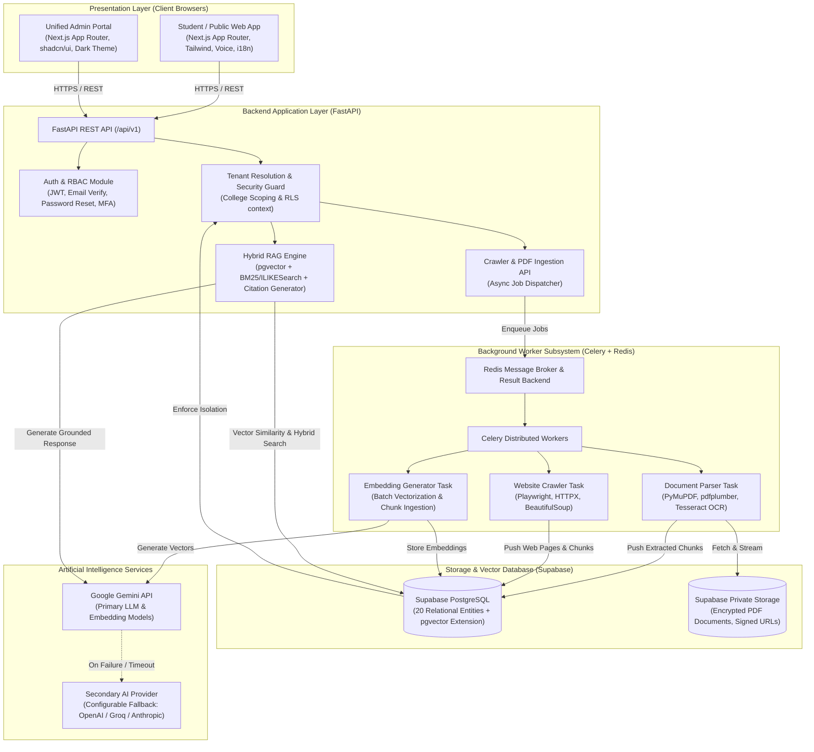

# System Architecture Specification

## 1. Executive Overview

The **AI FAQ College Chat Bot** is a multi-tenant SaaS platform built to serve multiple colleges and thousands of students simultaneously without data leakage, hallucinations, or unverified claims.

### Key Tenancy Rule
Each tenant corresponds to a distinct college (`colleges` table). Every document, website crawl, extracted fact, knowledge chunk, embedding, chat session, and user query is scoped directly to a `college_id`. 
Cross-college retrieval is prevented at three distinct levels:
1. **API Middleware**: Validates user access and binds tenant context to the database session.
2. **Database Queries**: Every query explicitly filters `WHERE college_id = :college_id`.
3. **Database RLS (Row-Level Security)**: Enforced in PostgreSQL so tenant boundaries cannot be breached even by faulty queries.

---

## 2. Component Topology



---

## 3. Core Subsystems

### 3.1. Authentication & Role-Based Access Control (RBAC)
- **Roles**:
  - `STUDENT`: Can select any approved college, chat with verified knowledge, maintain chat history, submit feedback.
  - `COLLEGE_ADMIN`: Strictly scoped to their single registered `college_id`. Can initiate crawls, upload PDFs, review facts, approve/publish knowledge, and view college analytics.
  - `SUPER_ADMIN`: Platform-wide governance. Can approve college onboarding requests, invite/disable admins, configure AI provider credentials, monitor token usage, and inspect audit logs.
- **Security Primitives**:
  - Passwords hashed using bcrypt / Argon2.
  - Short-lived Access Tokens (JWT) + Refresh Token rotation.
  - Email verification codes / magic links before activation.
  - Rate limiting via Redis on all authentication and AI generation endpoints.

### 3.2. Data Ingestion & Extraction Engine
- **Website Crawler**:
  - Uses `httpx` for fast static page parsing and `playwright` for JavaScript-rendered single-page applications.
  - Enforces `robots.txt` compliance, allowed domain whitelisting, maximum crawl depth, and rate throttling.
  - Content deduplication via SHA-256 content hashing.
- **PDF & Document Processing**:
  - Binary validation: validates MIME type, magic bytes (`%PDF-`), and file size limits (e.g. 50MB max).
  - Primary text extraction via `PyMuPDF` (`fitz`) for digital PDFs.
  - Structured table extraction via `pdfplumber`.
  - Fallback OCR via `pytesseract` for scanned or image-based pages.
  - Extracts and retains metadata: page numbers, bounding sections, and source filenames.

### 3.3. Knowledge Review & Publishing Pipeline
1. Extracted content is decomposed into `document_paragraphs` or `website_pages`.
2. Content is parsed into atomic `extracted_facts` and semantic `knowledge_chunks`.
3. Chunks enter `PENDING_REVIEW` status.
4. College Admins review facts in an administrative queue. They can edit content, accept facts, or reject inaccurate data.
5. Once marked `APPROVED`, an admin explicitly triggers `PUBLISHED`.
6. Only chunks with status `PUBLISHED` and `is_active = TRUE` are queried during student RAG retrieval.

### 3.4. Hybrid RAG (Retrieval-Augmented Generation)
- **Vector Search**: PostgreSQL `pgvector` performing cosine similarity on vector embeddings (768 or 1536 dimensions).
- **Keyword / Semantic Hybrid Retrieval**: Combines pgvector distance with PostgreSQL full-text search (`tsvector` / BM25-equivalent ranking) using Reciprocal Rank Fusion (RRF).
- **Tenant Isolation in Vector Queries**:
  ```sql
  SELECT id, chunk_text, 1 - (embedding <=> :query_vector) AS similarity
  FROM knowledge_chunks
  WHERE college_id = :college_id
    AND status = 'PUBLISHED'
    AND is_active = TRUE
  ORDER BY similarity DESC
  LIMIT 5;
  ```
- **Strict Evidence Ranking**:
  1. Priority 1: `OFFICIAL_WEBSITE`
  2. Priority 2: `ADMIN_VERIFIED`
  3. Priority 3: `GEMINI_UNVERIFIED` (labelled clearly with disclaimer)
  4. Priority 4: `SECONDARY_AI_FALLBACK` (failover when Gemini encounters outage or quota limits)
  5. Priority 5: `NO_RELIABLE_INFORMATION` (refusal with college contact info provided)

