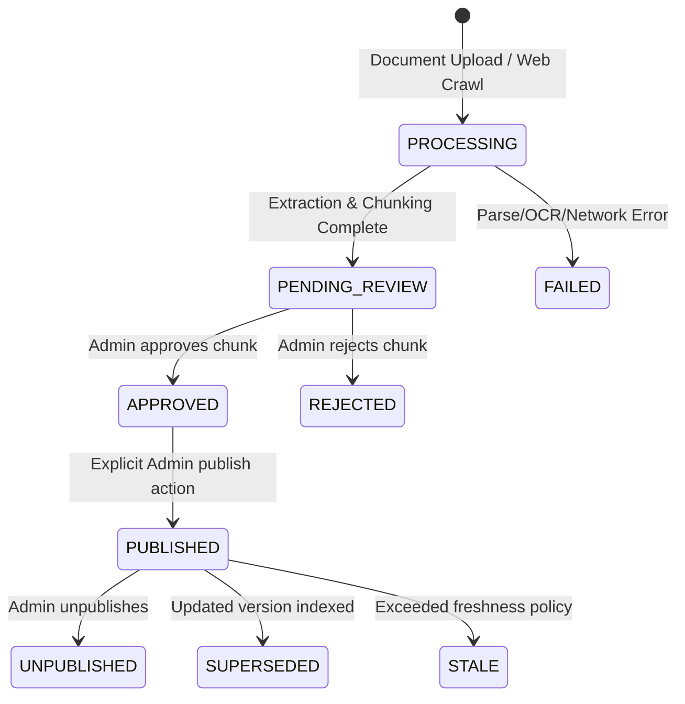

# Database Schema & Entity Relationship Specification

## 1. Relational Entity Overview

The database is built on **Supabase PostgreSQL** utilizing the **`pgvector`** extension. All entities use UUID v4 primary keys and UTC timestamps (`created_at`, `updated_at`).

### Tenancy Rule
Any data specific to an institution links directly to `colleges.id`. RLS policies verify that `current_setting('app.current_college_id', true)` matches `college_id`.

---

## 2. Mermaid Entity-Relationship Diagram

```mermaid
erDiagram
    colleges ||--o{ users : "has registered users"
    colleges ||--o{ college_memberships : "has admin memberships"
    users ||--o{ college_memberships : "belongs to"
    
    colleges ||--o{ website_sources : "owns crawl targets"
    website_sources ||--o{ crawl_jobs : "triggers"
    crawl_jobs ||--o{ crawl_job_events : "logs execution"
    website_sources ||--o{ website_pages : "discovers"
    
    colleges ||--o{ documents : "owns uploaded files"
    documents ||--o{ document_pages : "deconstructs into"
    document_pages ||--o{ document_paragraphs : "splits into"
    
    colleges ||--o{ extracted_facts : "contains"
    colleges ||--o{ knowledge_chunks : "indexes"
    knowledge_chunks ||--o{ knowledge_reviews : "audited by"
    users ||--o{ knowledge_reviews : "reviewed by"
    
    colleges ||--o{ chat_sessions : "hosts conversations"
    users ||--o{ chat_sessions : "participates in"
    chat_sessions ||--o{ chat_messages : "records"
    
    colleges ||--o{ feedback : "receives"
    chat_messages ||--o{ feedback : "evaluates"
    colleges ||--o{ support_tickets : "receives queries"
    users ||--o{ support_tickets : "opens"
    
    ai_provider_configs ||--o{ provider_events : "generates telemetry"
    users ||--o{ audit_logs : "triggers actions"
    colleges ||--o{ audit_logs : "records tenant events"

    colleges {
        uuid id PK
        string name
        string slug
        string official_domain
        string logo_url
        string contact_email
        string contact_phone
        string status
        boolean is_active
        timestamp created_at
        timestamp updated_at
    }

    users {
        uuid id PK
        string email
        string hashed_password
        string full_name
        string role
        boolean is_verified
        boolean is_active
        timestamp created_at
        timestamp updated_at
    }

    college_memberships {
        uuid id PK
        uuid college_id FK
        uuid user_id FK
        string role_in_college
        boolean is_primary
        timestamp created_at
    }

    website_sources {
        uuid id PK
        uuid college_id FK
        string base_url
        string allowed_subdomains
        int max_depth
        int max_pages
        string crawl_frequency
        boolean is_active
        timestamp last_crawled_at
    }

    crawl_jobs {
        uuid id PK
        uuid source_id FK
        uuid college_id FK
        string status
        int pages_discovered
        int pages_crawled
        int pages_failed
        string failure_reason
        timestamp started_at
        timestamp finished_at
    }

    crawl_job_events {
        uuid id PK
        uuid crawl_job_id FK
        string log_level
        string message
        jsonb metadata
        timestamp created_at
    }

    website_pages {
        uuid id PK
        uuid source_id FK
        uuid college_id FK
        string url
        string title
        string content_hash
        text raw_html
        text cleaned_text
        int http_status
        timestamp fetched_at
    }

    documents {
        uuid id PK
        uuid college_id FK
        string original_filename
        string storage_path
        string mime_type
        int file_size_bytes
        int total_pages
        string checksum_sha256
        string processing_status
        timestamp created_at
    }

    document_pages {
        uuid id PK
        uuid document_id FK
        int page_number
        text extracted_text
        boolean is_scanned
        boolean ocr_applied
        timestamp processed_at
    }

    document_paragraphs {
        uuid id PK
        uuid page_id FK
        uuid document_id FK
        int paragraph_index
        text paragraph_text
        jsonb bounding_box
    }

    extracted_facts {
        uuid id PK
        uuid college_id FK
        string source_type
        uuid source_id
        string category
        text fact_key
        text fact_value
        string verification_status
        timestamp created_at
    }

    knowledge_chunks {
        uuid id PK
        uuid college_id FK
        string source_type
        uuid source_id
        string source_url
        int page_number
        text chunk_text
        vector embedding
        string status
        boolean is_active
        timestamp created_at
    }

    knowledge_reviews {
        uuid id PK
        uuid chunk_id FK
        uuid reviewed_by_user_id FK
        string review_action
        text notes
        text edited_chunk_text
        timestamp created_at
    }

    chat_sessions {
        uuid id PK
        uuid college_id FK
        uuid user_id FK
        string session_title
        string language
        boolean is_active
        timestamp created_at
        timestamp updated_at
    }

    chat_messages {
        uuid id PK
        uuid session_id FK
        string sender_role
        text message_text
        boolean is_verified
        string answer_source_type
        jsonb source_citations
        int token_count
        timestamp created_at
    }

    ai_provider_configs {
        uuid id PK
        string provider_name
        string model_name
        boolean is_primary
        boolean is_active
        int timeout_seconds
        int max_retries
        timestamp updated_at
    }

    provider_events {
        uuid id PK
        uuid config_id FK
        string event_type
        int latency_ms
        int prompt_tokens
        int completion_tokens
        string error_message
        timestamp created_at
    }

    audit_logs {
        uuid id PK
        uuid college_id FK
        uuid actor_user_id FK
        string action_type
        string target_entity
        uuid target_id
        jsonb payload_diff
        string ip_address
        timestamp created_at
    }

    feedback {
        uuid id PK
        uuid college_id FK
        uuid message_id FK
        uuid user_id FK
        int rating
        text comments
        timestamp created_at
    }

    support_tickets {
        uuid id PK
        uuid college_id FK
        uuid user_id FK
        string subject
        text message
        string status
        timestamp created_at
    }
```

---

## 3. Knowledge Lifecycle Status Transitions

