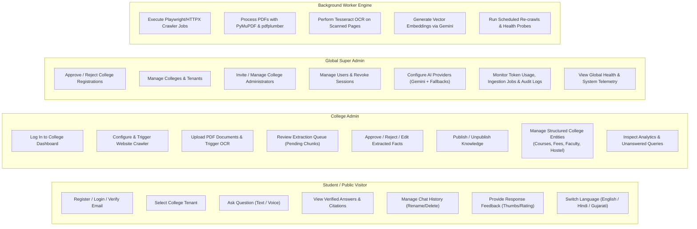
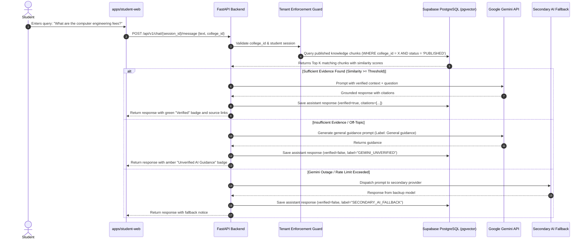
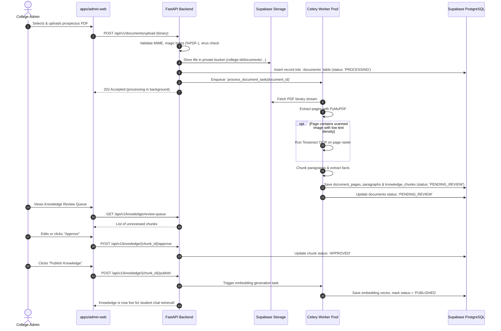

# Use Case Specifications

This document outlines the core functional interactions for each actor in the system:
1. **Regular User / Student**
2. **College Admin**
3. **Global Super Admin**
4. **Automated Celery Background Engine**

---

## 1. Actor-to-Use-Case Matrix

---

## 2. Key Sequence Workflows

### 2.1. Student Chat Request & RAG Evaluation Workflow

### 2.2. PDF Upload, OCR & Knowledge Publishing Workflow

